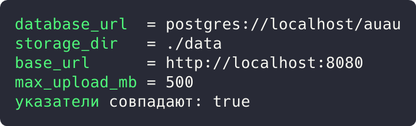
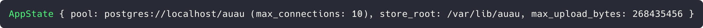

# Цель работы

Реализовать решение прикладной задачи из предметной области с использованием порождающих паттернов «Одиночка» и «Строитель».

# Ход работы

Прикладная задача: серверная часть платформы разметки аудиозаписей. Приложение хранит конфигурацию, пул соединений с PostgreSQL и состояние, объединяющее эти ресурсы.

## Задание 1. Паттерн «Одиночка»: глобальная конфигурация приложения

Конфигурация должна существовать в единственном экземпляре: глобальная точка доступа `Config::global()` инициализирует статическую переменную `CONFIG: OnceLock<Config>`. Повторные вызовы возвращают тот же объект, что проверяется сравнением указателей.

```rust
use std::path::PathBuf;
use std::sync::OnceLock;

#[derive(Debug, Clone)]
pub struct Config {
    pub database_url: String,
    pub storage_dir: PathBuf,
    pub base_url: String,
    pub max_upload_mb: u64,
}

static CONFIG: OnceLock<Config> = OnceLock::new();
```

Метод `Config::global()` инициализирует переменную лениво и потокобезопасно, возвращая ссылку с временем жизни `'static`.

```rust
impl Config {
    pub fn global() -> &'static Config {
        CONFIG.get_or_init(|| Config {
            database_url: std::env::var("DATABASE_URL")
                .unwrap_or_else(|_| "postgres://localhost/auau".into()),
            storage_dir: std::env::var("STORAGE_DIR")
                .unwrap_or_else(|_| "./data".into())
                .into(),
            base_url: std::env::var("BASE_URL")
                .unwrap_or_else(|_| "http://localhost:8080".into()),
            max_upload_mb: 500,
        })
    }
}

fn main() {
    let first = Config::global();
    let second = Config::global();

    println!("database_url  = {}", first.database_url);
    println!("storage_dir   = {}", first.storage_dir.display());
    println!("base_url      = {}", first.base_url);
    println!("max_upload_mb = {}", first.max_upload_mb);
    println!("указатели совпадают: {}", std::ptr::eq(first, second));
}
```



Рисунок 1 - Результат выполнения задания 1

Результат: единственный экземпляр конфигурации (database_url = `postgres://localhost/auau`, max_upload_mb = 500); оба обращения вернули один объект, указатели совпадают: true.

## Задание 2. Паттерн «Строитель»: пошаговая сборка пула и состояния приложения

Конструирование состояния (`AppState`) вынесено в строителя. Пул соединений создаётся строителем `PoolOptions` (по образцу `PgPoolOptions` из sqlx): цепочка вызовов настраивает и строит объект.

```rust
pub struct PoolOptions {
    max_connections: u32,
}

pub struct Pool {
    url: String,
    max_connections: u32,
}

impl PoolOptions {
    pub fn new() -> Self {
        Self { max_connections: 1 }
    }

    pub fn max_connections(mut self, n: u32) -> Self {
        self.max_connections = n;
        self
    }

    pub fn connect(self, url: &str) -> Pool {
        Pool { url: url.into(), max_connections: self.max_connections }
    }
}
```

Строитель `AppStateBuilder` пошагово задаёт пул, корень хранилища и лимит загрузки, а метод `build()` возвращает готовое состояние.

```rust
pub struct AppStateBuilder {
    pool: Option<Pool>,
    store_root: String,
    max_upload_bytes: usize,
}

pub struct AppState {
    pool: Pool,
    store_root: String,
    max_upload_bytes: usize,
}

impl AppStateBuilder {
    pub fn new() -> Self {
        Self { pool: None, store_root: "./data".into(), max_upload_bytes: 500 * 1024 * 1024 }
    }

    pub fn pool(mut self, pool: Pool) -> Self {
        self.pool = Some(pool);
        self
    }

    pub fn store_root(mut self, root: &str) -> Self {
        self.store_root = root.into();
        self
    }

    pub fn max_upload_mb(mut self, mb: usize) -> Self {
        self.max_upload_bytes = mb * 1024 * 1024;
        self
    }

    pub fn build(self) -> AppState {
        AppState {
            pool: self.pool.expect("pool is required"),
            store_root: self.store_root,
            max_upload_bytes: self.max_upload_bytes,
        }
    }
}
```

Сборка состояния одной цепочкой вызовов и вывод описания результата:

```rust
impl AppState {
    pub fn describe(&self) -> String {
        format!(
            "AppState {{ pool: {} (max_connections: {}), store_root: {}, max_upload_bytes: {} }}",
            self.pool.url, self.pool.max_connections, self.store_root, self.max_upload_bytes
        )
    }
}

fn main() {
    let pool = PoolOptions::new().max_connections(10).connect("postgres://localhost/auau");
    let state = AppStateBuilder::new()
        .pool(pool)
        .store_root("/var/lib/auau")
        .max_upload_mb(256)
        .build();
    println!("{}", state.describe());
}
```



Рисунок 2 - Результат выполнения задания 2

Результат: строитель собрал состояние за одну цепочку вызовов: `AppState { pool: postgres://localhost/auau (max_connections: 10), store_root: /var/lib/auau, max_upload_bytes: 268435456 }`.

# Вывод

Реализованы паттерны «Одиночка» и «Строитель»: синглтон дал единственный экземпляр конфигурации с ленивой инициализацией, строитель собрал сложные объекты цепочками вызовов. Корректность подтверждена выводом программ.
