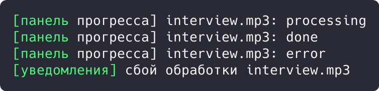
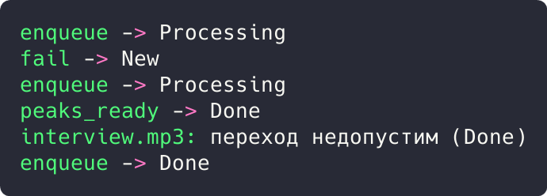

# Цель работы

Реализовать решение прикладной задачи из предметной области с использованием поведенческих паттернов «Наблюдатель» и «Состояние».

# Ход работы

## Задание 1. Паттерн «Наблюдатель»: события статуса файла

Подписчики (`ProgressPanel`, `Notifier`) реагируют на смену статуса аудиофайла. Наблюдатели не знают о файле ничего, кроме интерфейса оповещения; уведомления отправляет только метод `set_status()`.

```rust
trait StatusObserver {
    fn on_status(&self, file: &str, status: &str);
}

struct ProgressPanel;

impl StatusObserver for ProgressPanel {
    fn on_status(&self, file: &str, status: &str) {
        println!("[панель прогресса] {}: {}", file, status);
    }
}

struct Notifier;

impl StatusObserver for Notifier {
    fn on_status(&self, file: &str, status: &str) {
        if status == "error" {
            println!("[уведомления] сбой обработки {}", file);
        }
    }
}
```

Демонстрация решения:

```rust
struct AudioFile {
    name: String,
    status: String,
    observers: Vec<Box<dyn StatusObserver>>,
}

impl AudioFile {
    fn set_status(&mut self, status: &str) {
        self.status = status.into();
        for o in &self.observers {
            o.on_status(&self.name, &self.status);
        }
    }
}

fn main() {
    let mut file = AudioFile {
        name: "interview.mp3".into(),
        status: "new".into(),
        observers: vec![Box::new(ProgressPanel), Box::new(Notifier)],
    };
    file.set_status("processing");
    file.set_status("done");
    file.set_status("error");
}
```



Рисунок 1 - Результат выполнения задания 1

Результат: панель получила processing, done, error; уведомление отправлено только на сбой.

## Задание 2. Паттерн «Состояние»: жизненный цикл файла

Статусы файла (`new`, `processing`, `done`, `error`) оформлены конечным автоматом: метод `dispatch()` меняет поведение в зависимости от текущего состояния и события, повтор до 3 раз.

```rust
#[derive(Debug, PartialEq, Clone)]
enum FileStatus {
    New,
    Processing,
    Done,
    Error,
}

struct AudioFile {
    name: String,
    status: FileStatus,
    attempts: u32,
}
```

Демонстрация решения:

```rust
impl AudioFile {
    fn dispatch(&mut self, event: &str) {
        self.status = match (&self.status, event) {
            (FileStatus::New, "enqueue") => FileStatus::Processing,
            (FileStatus::Processing, "peaks_ready") => FileStatus::Done,
            (FileStatus::Processing, "fail") if self.attempts < 3 => {
                self.attempts += 1;
                FileStatus::New
            }
            (FileStatus::Processing, "fail") => FileStatus::Error,
            (s, _) => {
                println!("{}: переход недопустим ({:?})", self.name, s);
                s.clone()
            }
        };
        println!("{} -> {:?}", event, self.status);
    }
}

fn main() {
    let mut file = AudioFile { name: "interview.mp3".into(), status: FileStatus::New, attempts: 0 };
    file.dispatch("enqueue");
    file.dispatch("fail");
    file.dispatch("enqueue");
    file.dispatch("peaks_ready");
    file.dispatch("enqueue");
}
```



Рисунок 2 - Результат выполнения задания 2

Результат: путь `new -> processing -> new -> processing -> done`; повторная постановка отклонена в состоянии done.

# Вывод

Прикладная задача решена с использованием перечисленных паттернов; корректность подтверждена выводом программ.
