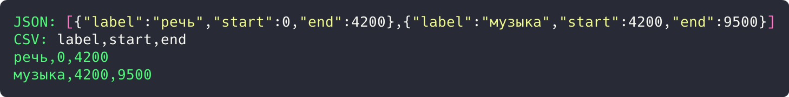
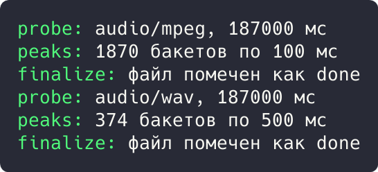

# Цель работы

Реализовать решение прикладной задачи из предметной области с использованием поведенческих паттернов «Стратегия» и «Шаблонный метод».

# Ход работы

## Задание 1. Паттерн «Стратегия»: форматы экспорта

Алгоритм сериализации вынесен в стратегии `JsonFormat` и `CsvFormat` с общим трейтом `ExportFormat`. Функция `export()` работает с любым форматом и подменяет алгоритм на лету.

```rust
trait ExportFormat {
    fn render(&self, segments: &[(String, u64, u64)]) -> String;
    fn name(&self) -> &'static str;
}

struct JsonFormat;

impl ExportFormat for JsonFormat {
    fn render(&self, segments: &[(String, u64, u64)]) -> String {
        let items: Vec<String> = segments
            .iter()
            .map(|(l, s, e)| format!("{{\"label\":\"{}\",\"start\":{},\"end\":{}}}", l, s, e))
            .collect();
        format!("[{}]", items.join(","))
    }
    fn name(&self) -> &'static str {
        "JSON"
    }
}

struct CsvFormat;
```

Демонстрация решения:

```rust
impl ExportFormat for CsvFormat {
    fn render(&self, segments: &[(String, u64, u64)]) -> String {
        let mut out = String::from("label,start,end\n");
        for (l, s, e) in segments {
            out.push_str(&format!("{},{},{}\n", l, s, e));
        }
        out.trim_end().to_string()
    }
    fn name(&self) -> &'static str {
        "CSV"
    }
}

fn export(format: &dyn ExportFormat, segments: &[(String, u64, u64)]) {
    println!("{}: {}", format.name(), format.render(segments));
}

fn main() {
    let segments = vec![("речь".into(), 0, 4_200), ("музыка".into(), 4_200, 9_500)];
    export(&JsonFormat, &segments);
    export(&CsvFormat, &segments);
}
```



Рисунок 1 - Результат выполнения задания 1

Результат: один и тот же набор сегментов выведен в JSON и в CSV (заголовок `label,start,end` и две строки).

## Задание 2. Паттерн «Шаблонный метод»: конвейер обработки

Каркас конвейера (probe, peaks, finalize) зафиксирован в методе `run()` трейта `Pipeline`, а шаги переопределяют подклассы для форматов MP3 и WAV.

```rust
trait Pipeline {
    fn probe(&self) -> String;
    fn peaks(&self, duration_ms: u64) -> String;
    fn finalize(&self) -> String {
        "файл помечен как done".into()
    }

    fn run(&self) {
        let duration = self.probe();
        let peaks = self.peaks(187_000);
        println!("probe: {}", duration);
        println!("peaks: {}", peaks);
        println!("finalize: {}", self.finalize());
    }
}

struct Mp3Pipeline;

impl Pipeline for Mp3Pipeline {
    fn probe(&self) -> String {
        "audio/mpeg, 187000 мс".into()
    }
```

Демонстрация решения:

```rust
    fn peaks(&self, duration_ms: u64) -> String {
        format!("{} бакетов по 100 мс", duration_ms / 100)
    }
}

struct WavPipeline;

impl Pipeline for WavPipeline {
    fn probe(&self) -> String {
        "audio/wav, 187000 мс".into()
    }

    fn peaks(&self, duration_ms: u64) -> String {
        format!("{} бакетов по 500 мс", duration_ms / 500)
    }
}

fn main() {
    Mp3Pipeline.run();
    WavPipeline.run();
}
```



Рисунок 2 - Результат выполнения задания 2

Результат: оба конвейера прошли одинаковый каркас; MP3 дал 1870 бакетов по 100 мс, WAV 374 по 500 мс.

# Вывод

Прикладная задача решена с использованием перечисленных паттернов; корректность подтверждена выводом программ.
