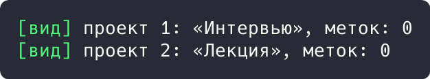

# Цель работы

Реализовать решение прикладной задачи из предметной области с использованием одного из архитектурных паттернов: MVC.

# Ход работы

## Задание 1. Паттерн «MVC»: проекты

Модель `ProjectModel` хранит проекты и бизнес-правила, вид `ProjectView` только отображает, контроллер `ProjectController` принимает команды и связывает модель с видом.

```rust
#[derive(Clone)]
struct Project {
    id: u32,
    name: String,
    labels: Vec<String>,
}

struct ProjectModel {
    projects: Vec<Project>,
}

impl ProjectModel {
    fn add(&mut self, name: &str) -> Project {
        let p = Project { id: self.projects.len() as u32 + 1, name: name.into(), labels: vec![] };
        self.projects.push(p.clone());
        p
    }

    fn get(&self, id: u32) -> Option<Project> {
        self.projects.iter().find(|p| p.id == id).cloned()
    }
}

struct ProjectView;

impl ProjectView {
    fn render(&self, p: &Project) {
        println!("[вид] проект {}: «{}», меток: {}", p.id, p.name, p.labels.len());
    }
}
```

Демонстрация решения:

```rust
struct ProjectController {
    model: ProjectModel,
    view: ProjectView,
}

impl ProjectController {
    fn create(&mut self, name: &str) -> &Project {
        self.model.add(name);
        self.model.projects.last().unwrap()
    }

    fn show(&self, id: u32) {
        if let Some(p) = self.model.get(id) {
            self.view.render(&p);
        }
    }
}

fn main() {
    let mut controller = ProjectController { model: ProjectModel { projects: vec![] }, view: ProjectView };
    controller.create("Интервью");
    controller.create("Лекция");
    controller.show(1);
    controller.show(2);
}
```



Рисунок 1 - Результат выполнения задания 1

Результат: контроллер создал проекты «Интервью» и «Лекция», вид отрисовал оба.

# Вывод

Прикладная задача решена с использованием перечисленных паттернов; корректность подтверждена выводом программ.
