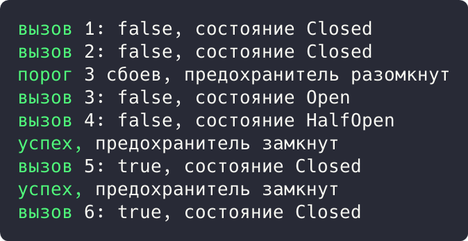

# Цель работы

Реализовать решение прикладной задачи из предметной области с использованием одного из паттернов микросервисов: Circuit Breaker.

# Ход работы

## Задание 1. Предохранитель для вызовов OIDC-провайдера

Вызовы провайдера защищены `CircuitBreaker`: после 3 сбоев подряд предохранитель размыкается и запросы не отправляются, затем полузамкнутое состояние пробует восстановить работу.

```rust
#[derive(Debug, PartialEq)]
enum BreakerState {
    Closed,
    Open,
    HalfOpen,
}

struct CircuitBreaker {
    state: BreakerState,
    failures: u32,
    threshold: u32,
}
```

Демонстрация решения:

```rust
impl CircuitBreaker {
    fn call<F>(&mut self, mut request: F) -> Result<String, String>
    where
        F: FnMut() -> Result<String, String>,
    {
        match self.state {
            BreakerState::Open => {
                self.state = BreakerState::HalfOpen;
                return Err("предохранитель разомкнут, запрос не отправлен".into());
            }
            BreakerState::HalfOpen | BreakerState::Closed => {}
        }
        match request() {
            Ok(v) => {
                self.failures = 0;
                self.state = BreakerState::Closed;
                println!("успех, предохранитель замкнут");
                Ok(v)
            }
            Err(e) => {
                self.failures += 1;
                if self.failures >= self.threshold {
                    self.state = BreakerState::Open;
                    println!("порог {} сбоев, предохранитель разомкнут", self.threshold);
                }
                Err(e)
            }
        }
    }
}
```

Продолжение решения:

```rust
fn main() {
    let mut breaker = CircuitBreaker { state: BreakerState::Closed, failures: 0, threshold: 3 };
    let mut attempts = 0;
    for i in 1..=6 {
        let result = breaker.call(|| {
            attempts += 1;
            if attempts <= 3 { Err("провайдер недоступен".into()) } else { Ok("token-payload".into()) }
        });
        println!("вызов {}: {:?}, состояние {:?}", i, result.is_ok(), breaker.state);
    }
}
```



Рисунок 1 - Результат выполнения задания 1

Результат: три сбоя разомкнули предохранитель, вызов 4 не отправлен; успешный вызов 5 замкнул его обратно.

# Вывод

Прикладная задача решена с использованием перечисленных паттернов; корректность подтверждена выводом программ.
