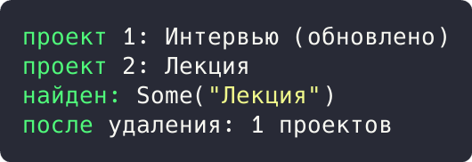

# Цель работы

Реализовать решение прикладной задачи из предметной области с использованием одного из системных паттернов: Repository.

# Ход работы

## Задание 1. Репозиторий проектов

Трейт `ProjectRepository` имитирует коллекцию проектов (save, find, all, delete), скрывая слой данных. Реализация `InMemoryProjectRepository` хранит строки в памяти, бизнес-логика работает только с трейтом.

```rust
struct Project {
    id: i64,
    name: String,
}

trait ProjectRepository {
    fn save(&mut self, project: &Project);
    fn find(&self, id: i64) -> Option<&Project>;
    fn all(&self) -> Vec<&Project>;
    fn delete(&mut self, id: i64);
}

struct InMemoryProjectRepository {
    rows: Vec<Project>,
}

impl ProjectRepository for InMemoryProjectRepository {
    fn save(&mut self, project: &Project) {
        if let Some(row) = self.rows.iter_mut().find(|p| p.id == project.id) {
            row.name = project.name.clone();
        } else {
            self.rows.push(Project { id: project.id, name: project.name.clone() });
        }
    }
```

Демонстрация решения:

```rust
    fn find(&self, id: i64) -> Option<&Project> {
        self.rows.iter().find(|p| p.id == id)
    }

    fn all(&self) -> Vec<&Project> {
        self.rows.iter().collect()
    }

    fn delete(&mut self, id: i64) {
        self.rows.retain(|p| p.id != id);
    }
}

fn main() {
    let mut repo = InMemoryProjectRepository { rows: vec![] };
    repo.save(&Project { id: 1, name: "Интервью".into() });
    repo.save(&Project { id: 2, name: "Лекция".into() });
    repo.save(&Project { id: 1, name: "Интервью (обновлено)".into() });
    for p in repo.all() {
        println!("проект {}: {}", p.id, p.name);
    }
    println!("найден: {:?}", repo.find(2).map(|p| &p.name));
    repo.delete(2);
    println!("после удаления: {} проектов", repo.all().len());
}
```



Рисунок 1 - Результат выполнения задания 1

Результат: проект 1 обновлён, проект 2 найден (`Some("Лекция")`), после удаления остался 1 проект.

# Вывод

Прикладная задача решена с использованием перечисленных паттернов; корректность подтверждена выводом программ.
