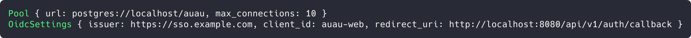
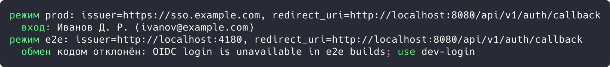

# Цель работы

Реализовать решение прикладной задачи из предметной области с использованием двух порождающих паттернов из списка: «Абстрактная фабрика», «Фабричный метод», «Прототип».

# Ход работы

## Задание 1. Паттерн «Фабричный метод»: фабрики пула и настроек OIDC

Создание объектов сосредоточено в методах-фабриках. `Pool::from_url()` строит пул из строки подключения, подставляя значения по умолчанию; вызывающий код получает готовый объект без деталей подготовки.

```rust
pub struct Config {
    pub database_url: String,
    pub oidc_issuer: String,
    pub oidc_client_id: String,
}

pub struct Pool {
    url: String,
    max_connections: u32,
}

pub struct OidcSettings {
    pub issuer: String,
    pub client_id: String,
    pub redirect_uri: String,
}

impl Pool {
    pub fn from_url(url: &str) -> Self {
        Self { url: url.into(), max_connections: 10 }
    }
}
```

`OidcSettings::new()` вычисляет адрес обратного вызова из базового URL. Демонстрация:

```rust
impl OidcSettings {
    pub fn new(config: &Config, base_url: &str) -> Self {
        Self {
            issuer: config.oidc_issuer.clone(),
            client_id: config.oidc_client_id.clone(),
            redirect_uri: format!("{}/api/v1/auth/callback", base_url),
        }
    }
}

fn main() {
    let config = Config {
        database_url: "postgres://localhost/auau".into(),
        oidc_issuer: "https://sso.example.com".into(),
        oidc_client_id: "auau-web".into(),
    };

    let pool = Pool::from_url(&config.database_url);
    let settings = OidcSettings::new(&config, "http://localhost:8080");

    println!("Pool {{ url: {}, max_connections: {} }}", pool.url, pool.max_connections);
    println!(
        "OidcSettings {{ issuer: {}, client_id: {}, redirect_uri: {} }}",
        settings.issuer, settings.client_id, settings.redirect_uri
    );
}
```



Рисунок 1 - Результат выполнения задания 1

Результат: фабричные методы вернули готовые объекты: `Pool { url: postgres://localhost/auau, max_connections: 10 }` и `OidcSettings { issuer: https://sso.example.com, client_id: auau-web, redirect_uri: http://localhost:8080/api/v1/auth/callback }`.

## Задание 2. Паттерн «Абстрактная фабрика»: семейство объектов аутентификации

Приложение работает в двух средах: продуктивной (OIDC-провайдер Pocket ID) и e2e (без провайдера). Для каждой создается семейство продуктов: обменщик кода (`CodeExchanger`) и настройки OIDC. Интерфейс задает трейт `AuthFactory`.

```rust
pub trait CodeExchanger {
    fn exchange(&self, code: &str) -> Result<ExchangedUser, String>;
}

pub struct OidcSettings {
    pub issuer: String,
    pub client_id: String,
    pub redirect_uri: String,
}

pub trait AuthFactory {
    fn exchanger(&self) -> Box<dyn CodeExchanger>;
    fn settings(&self) -> OidcSettings;
}

pub struct ProdAuthFactory {
    issuer: String,
    client_id: String,
    base_url: String,
}

impl AuthFactory for ProdAuthFactory {
    fn exchanger(&self) -> Box<dyn CodeExchanger> {
        Box::new(PocketIdExchanger)
    }

    fn settings(&self) -> OidcSettings {
        OidcSettings {
            issuer: self.issuer.clone(),
            client_id: self.client_id.clone(),
            redirect_uri: format!("{}/api/v1/auth/callback", self.base_url),
        }
    }
}
```

E2e-фабрика вместо провайдера выдает заглушку, а функция `make_factory()` выбирает семейство по режиму.

```rust
pub struct E2eAuthFactory;

impl AuthFactory for E2eAuthFactory {
    fn exchanger(&self) -> Box<dyn CodeExchanger> {
        Box::new(NoIdpExchanger)
    }

    fn settings(&self) -> OidcSettings {
        OidcSettings {
            issuer: "http://localhost:4180".into(),
            client_id: "auau-e2e".into(),
            redirect_uri: "http://localhost:8080/api/v1/auth/callback".into(),
        }
    }
}

fn main() {
    for mode in ["prod", "e2e"] {
        let factory = make_factory(mode);
        let settings = factory.settings();
        println!("режим {}: issuer={}, redirect_uri={}", mode, settings.issuer, settings.redirect_uri);
        match factory.exchanger().exchange("auth-code-42") {
            Ok(user) => println!("  вход: {} ({})", user.name, user.email),
            Err(err) => println!("  обмен кодом отклонён: {}", err),
        }
    }
}
```



Рисунок 2 - Результат выполнения задания 2

Результат: в режиме prod фабрика выдала настройки `issuer=https://sso.example.com` и обмен кодом завершился входом пользователя Иванов Д. Р. (`ivanov@example.com`); в режиме e2e фабрика выдала заглушку, и обмен кодом отклонен с сообщением об использовании dev-login.

# Вывод

Реализованы паттерны «Фабричный метод» и «Абстрактная фабрика»: фабричные методы централизовали создание объектов, фабрика дала согласованные семейства объектов аутентификации для двух сред. Корректность подтверждена выводом программ.
