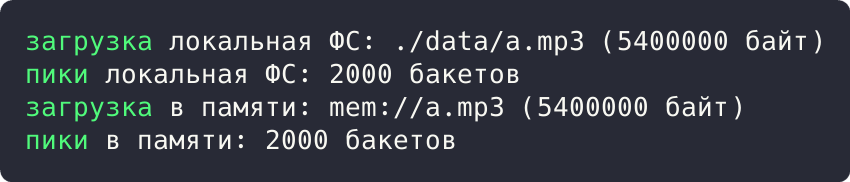

# Цель работы

Реализовать решение прикладной задачи из предметной области с использованием структурных паттернов «Адаптер» и «Мост».

# Ход работы

## Задание 1. Паттерн «Адаптер»: единый интерфейс пробника аудио

Формат-специфичный пробник возвращает данные через свои методы (`container_name`, `total_duration_ms`). Адаптер `ProbeAdapter` оборачивает его в единый интерфейс `AudioInfo`, которым пользуется остальной код приложения.

```rust
struct SymphoniaProbe {
    container: String,
    duration_ms: u64,
}

impl SymphoniaProbe {
    fn container_name(&self) -> &str {
        &self.container
    }

    fn total_duration_ms(&self) -> u64 {
        self.duration_ms
    }
}

trait AudioInfo {
    fn describe(&self) -> String;
}

struct ProbeAdapter(SymphoniaProbe);
```

Демонстрация решения:

```rust
impl AudioInfo for ProbeAdapter {
    fn describe(&self) -> String {
        format!(
            "контейнер {}, длительность {} мс",
            self.0.container_name(),
            self.0.total_duration_ms()
        )
    }
}

fn main() {
    let raw = SymphoniaProbe {
        container: "audio/mpeg".into(),
        duration_ms: 187_000,
    };
    let info = ProbeAdapter(raw);
    println!("upload.mp3: {}", info.describe());
}
```


Рисунок 1 - Результат выполнения задания 1

Результат: адаптер вернул описание по единому интерфейсу: `upload.mp3: контейнер audio/mpeg, длительность 187000 мс`.

## Задание 2. Паттерн «Мост»: операции и хранилища разделены

Абстракция (операции `Upload` и `Peaks`) отделена от реализации (хранилища на локальной ФС и в памяти). Деревья не связаны: операции работают с трейтом `StorageBackend`, а хранилища ничего не знают об операциях.

```rust
trait StorageBackend {
    fn put(&self, key: &str, bytes: usize) -> String;
    fn name(&self) -> &'static str;
}

struct FsBackend;
struct MemoryBackend;

impl StorageBackend for FsBackend {
    fn put(&self, key: &str, bytes: usize) -> String {
        format!("./data/{} ({} байт)", key, bytes)
    }
    fn name(&self) -> &'static str {
        "локальная ФС"
    }
}

impl StorageBackend for MemoryBackend {
    fn put(&self, key: &str, bytes: usize) -> String {
        format!("mem://{} ({} байт)", key, bytes)
    }
    fn name(&self) -> &'static str {
        "в памяти"
    }
}

trait MediaOperation {
    fn run(&self, backend: &dyn StorageBackend) -> String;
}

struct Upload {
    key: String,
    bytes: usize,
}
```

Демонстрация решения:

```rust
impl MediaOperation for Upload {
    fn run(&self, backend: &dyn StorageBackend) -> String {
        format!("загрузка {}: {}", backend.name(), backend.put(&self.key, self.bytes))
    }
}

struct Peaks {
    buckets: usize,
}

impl MediaOperation for Peaks {
    fn run(&self, backend: &dyn StorageBackend) -> String {
        format!("пики {}: {} бакетов", backend.name(), self.buckets)
    }
}

fn main() {
    let operations: Vec<Box<dyn MediaOperation>> = vec![
        Box::new(Upload { key: "a.mp3".into(), bytes: 5_400_000 }),
        Box::new(Peaks { buckets: 2_000 }),
    ];
    let backends: Vec<Box<dyn StorageBackend>> =
        vec![Box::new(FsBackend), Box::new(MemoryBackend)];
    for backend in &backends {
        for op in &operations {
            println!("{}", op.run(backend.as_ref()));
        }
    }
}
```



Рисунок 2 - Результат выполнения задания 2

Результат: обе операции выполнены над обоими хранилищами независимо: файл записан в `./data/a.mp3` и в `mem://a.mp3`.

# Вывод

Прикладная задача решена с использованием перечисленных паттернов; корректность подтверждена выводом программ.
