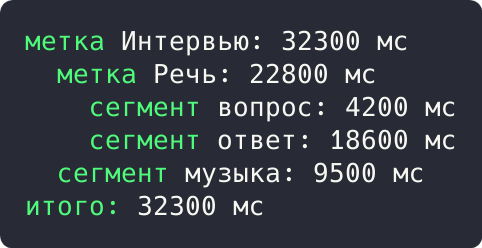
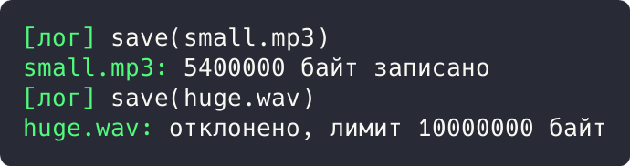

# Цель работы

Реализовать решение прикладной задачи из предметной области с использованием структурных паттернов «Компоновщик» и «Декоратор».

# Ход работы

## Задание 1. Паттерн «Компоновщик»: дерево проекта

Проект и метка являются компоновщиками (`Label`), сегмент является листом (`Segment`); оба реализуют трейт `TimelineNode`. Клиент считает суммарную длительность дерева единым вызовом, не различая типы узлов.

```rust
trait TimelineNode {
    fn duration_ms(&self) -> u64;
    fn describe(&self, indent: &str) -> String;
}

struct Segment {
    name: String,
    duration_ms: u64,
}

impl TimelineNode for Segment {
    fn duration_ms(&self) -> u64 {
        self.duration_ms
    }

    fn describe(&self, indent: &str) -> String {
        format!("{}сегмент {}: {} мс\n", indent, self.name, self.duration_ms)
    }
}

struct Label {
    name: String,
    children: Vec<Box<dyn TimelineNode>>,
}

impl Label {
    fn add(&mut self, node: Box<dyn TimelineNode>) {
        self.children.push(node);
    }
}
```

Демонстрация решения:

```rust
impl TimelineNode for Label {
    fn duration_ms(&self) -> u64 {
        self.children.iter().map(|c| c.duration_ms()).sum()
    }

    fn describe(&self, indent: &str) -> String {
        let mut out = format!("{}метка {}: {} мс\n", indent, self.name, self.duration_ms());
        for child in &self.children {
            out.push_str(&child.describe(&format!("{}  ", indent)));
        }
        out
    }
}

fn main() {
    let mut project = Label { name: "Интервью".into(), children: vec![] };
    let mut speech = Label { name: "Речь".into(), children: vec![] };
    speech.add(Box::new(Segment { name: "вопрос".into(), duration_ms: 4_200 }));
    speech.add(Box::new(Segment { name: "ответ".into(), duration_ms: 18_600 }));
    project.add(Box::new(speech));
    project.add(Box::new(Segment { name: "музыка".into(), duration_ms: 9_500 }));
    println!("{}", project.describe("").trim_end());
    println!("итого: {} мс", project.duration_ms());
}
```



Рисунок 1 - Результат выполнения задания 1

Результат: дерево собрано и посчитано: метка «Речь» 22800 мс, проект «Интервью» итого 32300 мс.

## Задание 2. Паттерн «Декоратор»: обёртки над хранилищем

Базовое хранилище `FsStore` оборачивается декораторами `LimitStore` (квота размера) и `LoggingStore` (журнал). Все обёртки реализуют один трейт `MediaStore` и наращивают обязанности на лету.

```rust
trait MediaStore {
    fn save(&self, key: &str, bytes: usize) -> String;
}

struct FsStore;

impl MediaStore for FsStore {
    fn save(&self, key: &str, bytes: usize) -> String {
        format!("{}: {} байт записано", key, bytes)
    }
}

struct LoggingStore {
    inner: Box<dyn MediaStore>,
}

impl MediaStore for LoggingStore {
    fn save(&self, key: &str, bytes: usize) -> String {
        let result = self.inner.save(key, bytes);
        println!("[лог] save({})", key);
        result
    }
}
```

Демонстрация решения:

```rust
struct LimitStore {
    inner: Box<dyn MediaStore>,
    max_bytes: usize,
}

impl MediaStore for LimitStore {
    fn save(&self, key: &str, bytes: usize) -> String {
        if bytes > self.max_bytes {
            return format!("{}: отклонено, лимит {} байт", key, self.max_bytes);
        }
        self.inner.save(key, bytes)
    }
}

fn main() {
    let store = LoggingStore {
        inner: Box::new(LimitStore { inner: Box::new(FsStore), max_bytes: 10_000_000 }),
    };
    println!("{}", store.save("small.mp3", 5_400_000));
    println!("{}", store.save("huge.wav", 800_000_000));
}
```



Рисунок 2 - Результат выполнения задания 2

Результат: `small.mp3` (5400000 байт) записан, `huge.wav` (800000000 байт) отклонён лимитом 10000000 байт; обе операции залогированы.

# Вывод

Прикладная задача решена с использованием перечисленных паттернов; корректность подтверждена выводом программ.
