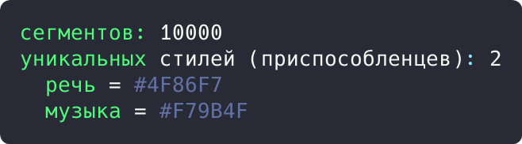

# Цель работы

Реализовать решение прикладной задачи из предметной области с использованием структурных паттернов «Фасад» и «Приспособленец».

# Ход работы

## Задание 1. Паттерн «Фасад»: экспорт аннотаций

Экспорт требует загрузки сегментов из БД и проверки готовности пиков в хранилище. Фасад `AnnotationFacade` скрывает обе подсистемы за одним методом `export()`.

```rust
struct Db {
    segments: Vec<(String, u64, u64)>,
}

impl Db {
    fn load_segments(&self, project: &str) -> Vec<(String, u64, u64)> {
        self.segments.clone()
    }
}

struct PeaksStore {
    files: Vec<String>,
}

impl PeaksStore {
    fn has_peaks(&self, name: &str) -> bool {
        self.files.iter().any(|f| f == name)
    }
}

struct AnnotationFacade {
    db: Db,
    peaks: PeaksStore,
}
```

Демонстрация решения:

```rust
impl AnnotationFacade {
    fn export(&self, project: &str) -> String {
        let segments = self.db.load_segments(project);
        let audio_ready = self.peaks.has_peaks("interview.mp3");
        let json: Vec<String> = segments
            .iter()
            .map(|(label, start, end)| format!("{{\"label\":\"{}\",\"start\":{},\"end\":{}}}", label, start, end))
            .collect();
        format!(
            "экспорт «{}»: {} сегментов, пики ready={}",
            project,
            json.len(),
            audio_ready
        )
    }
}

fn main() {
    let facade = AnnotationFacade {
        db: Db { segments: vec![("речь".into(), 0, 4_200), ("музыка".into(), 4_200, 9_500)] },
        peaks: PeaksStore { files: vec!["interview.mp3".into()] },
    };
    println!("{}", facade.export("Интервью"));
}
```


Рисунок 1 - Результат выполнения задания 1

Результат: `экспорт «Интервью»: 2 сегментов, пики ready=true` одним вызовом фасада.

## Задание 2. Паттерн «Приспособленец»: общие стили меток

Тысячи сегментов ссылаются на разделяемые стили меток, выдаваемые фабрикой `StyleFactory`. Тяжелое состояние (имя, цвет) хранится один раз, сегменты несут только идентификатор стиля и время.

```rust
struct LabelStyle {
    name: String,
    color: String,
}

struct StyleFactory {
    styles: Vec<LabelStyle>,
}

impl StyleFactory {
    fn get(&mut self, name: &str, color: &str) -> usize {
        if let Some(idx) = self.styles.iter().position(|s| s.name == name) {
            return idx;
        }
        self.styles.push(LabelStyle { name: name.into(), color: color.into() });
        self.styles.len() - 1
    }
}

struct Segment {
    style_id: usize,
    start_ms: u64,
    end_ms: u64,
}
```

Демонстрация решения:

```rust
fn main() {
    let mut factory = StyleFactory { styles: vec![] };
    let speech = factory.get("речь", "#4F86F7");
    let music = factory.get("музыка", "#F79B4F");

    let segments: Vec<Segment> = (0..10_000)
        .map(|i| Segment {
            style_id: if i % 3 == 0 { music } else { speech },
            start_ms: i * 100,
            end_ms: i * 100 + 90,
        })
        .collect();

    println!("сегментов: {}", segments.len());
    println!("уникальных стилей (приспособленцев): {}", factory.styles.len());
    for s in &factory.styles {
        println!("  {} = {}", s.name, s.color);
    }
}
```



Рисунок 2 - Результат выполнения задания 2

Результат: 10000 сегментов используют всего 2 разделяемых стиля: `речь = #4F86F7`, `музыка = #F79B4F`.

# Вывод

Прикладная задача решена фасадом и приспособленцем: фасад скрыл экспорт аннотаций за одним методом, а разделяемые стили меток сократили память при тысячах сегментов. Такой же фасад экспорта и разделение стилей применены в реальном приложении. Корректность подтверждена выводом программ.
