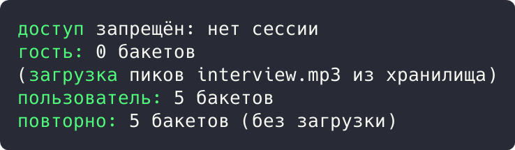

# Цель работы

Реализовать решение прикладной задачи из предметной области с использованием структурного паттерна «Заместитель».

# Ход работы

## Задание 1. Паттерн «Заместитель»: защищённый доступ к медиа

Загрузка пиков волосяной формы дорога и требует прав доступа. Заместитель `ProtectedAudio` реализует тот же интерфейс `AudioAccess`: проверяет сессию, а тяжелые данные читает из хранилища лениво и кэширует.

```rust
struct HeavyPeaks {
    buckets: Vec<u32>,
}

impl HeavyPeaks {
    fn load(file: &str) -> Self {
        println!("(загрузка пиков {} из хранилища)", file);
        HeavyPeaks { buckets: vec![12, 48, 96, 30, 64] }
    }
}

trait AudioAccess {
    fn buckets(&mut self) -> &[u32];
}

struct ProtectedAudio {
    file: String,
    token: Option<String>,
    peaks: Option<HeavyPeaks>,
}

impl ProtectedAudio {
    fn new(file: &str, token: Option<String>) -> Self {
        ProtectedAudio { file: file.into(), token, peaks: None }
    }
}
```

Демонстрация решения:

```rust
impl AudioAccess for ProtectedAudio {
    fn buckets(&mut self) -> &[u32] {
        if self.token.is_none() {
            println!("доступ запрещён: нет сессии");
            return &[];
        }
        if self.peaks.is_none() {
            self.peaks = Some(HeavyPeaks::load(&self.file));
        }
        self.peaks.as_ref().unwrap().buckets.as_slice()
    }
}

fn main() {
    let mut guest = ProtectedAudio::new("interview.mp3", None);
    println!("гость: {:?} бакетов", guest.buckets().len());

    let mut user = ProtectedAudio::new("interview.mp3", Some("sess-42".into()));
    println!("пользователь: {:?} бакетов", user.buckets().len());
    println!("повторно: {:?} бакетов (без загрузки)", user.buckets().len());
}
```



Рисунок 1 - Результат выполнения задания 1

Результат: гость получил отказ, пользователь 5 бакетов; повторное обращение вернуло кэш без загрузки.

# Вывод

Прикладная задача решена с использованием перечисленных паттернов; корректность подтверждена выводом программ.
