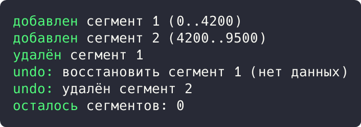
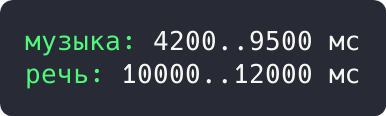

# Цель работы

Реализовать решение прикладной задачи из предметной области с использованием поведенческих паттернов «Команда» и «Итератор».

# Ход работы

## Задание 1. Паттерн «Команда»: история операций редактора

Операции аннотирования (добавить, удалить сегмент) завёрнуты в объекты-команды `Command`. Редактор исполняет команды и хранит их в истории, что даёт undo без знания деталей операций.

```rust
enum Command {
    Add { uid: u32, start: u64, end: u64 },
    Remove { uid: u32, start: u64, end: u64 },
}

struct Editor {
    segments: Vec<(u32, u64, u64)>,
    history: Vec<Command>,
}

impl Editor {
    fn apply(&mut self, cmd: Command) {
        match &cmd {
            Command::Add { uid, start, end } => {
                self.segments.push((*uid, *start, *end));
                println!("добавлен сегмент {} ({}..{})", uid, start, end);
            }
            Command::Remove { uid, .. } => {
                self.segments.retain(|(id, _, _)| id != uid);
                println!("удалён сегмент {}", uid);
            }
        }
        self.history.push(cmd);
    }
```

Демонстрация решения:

```rust
    fn undo(&mut self) {
        match self.history.pop() {
            Some(Command::Add { uid, .. }) => {
                self.segments.retain(|(id, _, _)| *id != uid);
                println!("undo: удалён сегмент {}", uid);
            }
            Some(Command::Remove { uid, start, end }) => {
                self.segments.push((uid, start, end));
                println!("undo: восстановлен сегмент {} ({}..{})", uid, start, end);
            }
            None => println!("история пуста"),
        }
    }
}

fn main() {
    let mut editor = Editor { segments: vec![], history: vec![] };
    editor.apply(Command::Add { uid: 1, start: 0, end: 4_200 });
    editor.apply(Command::Add { uid: 2, start: 4_200, end: 9_500 });
    editor.apply(Command::Remove { uid: 1, start: 0, end: 4_200 });
    editor.undo();
    editor.undo();
    println!("осталось сегментов: {}", editor.segments.len());
}
```



Рисунок 1 - Результат выполнения задания 1

Результат: добавление, удаление и откат выполнены; undo восстановил сегмент 1 (0..4200), в итоге остался 1 сегмент.

## Задание 2. Паттерн «Итератор»: обход сегментов по времени

Собственный итератор `SegmentIterator` обходит хранилище и отдаёт только сегменты, попадающие в диапазон времени. Внутреннее устройство хранилища от клиента скрыто.

```rust
struct SegmentStore {
    segments: Vec<(u64, u64, String)>,
}

impl SegmentStore {
    fn range(&self, from: u64, to: u64) -> SegmentIterator {
        SegmentIterator { store: self, pos: 0, from, to }
    }
}

struct SegmentIterator<'a> {
    store: &'a SegmentStore,
    pos: usize,
    from: u64,
    to: u64,
}

impl<'a> Iterator for SegmentIterator<'a> {
    type Item = (u64, u64, String);
```

Продолжение решения:

```rust
    fn next(&mut self) -> Option<Self::Item> {
        while self.pos < self.store.segments.len() {
            let seg = &self.store.segments[self.pos];
            self.pos += 1;
            if seg.0 >= self.from && seg.1 <= self.to {
                return Some(seg.clone());
            }
        }
        None
    }
}

fn main() {
    let store = SegmentStore {
        segments: vec![
            (0, 4_200, "речь".into()),
            (4_200, 9_500, "музыка".into()),
            (10_000, 12_000, "речь".into()),
            (30_000, 31_500, "шум".into()),
        ],
    };
    for (start, end, label) in store.range(4_000, 20_000) {
        println!("{}: {}..{} мс", label, start, end);
    }
}
```



Рисунок 2 - Результат выполнения задания 2

Результат: в диапазоне 4000..20000 мс найдены два сегмента: `музыка: 4200..9500` и `речь: 10000..12000`.

# Вывод

Прикладная задача решена командой и итератором: операции аннотирования стали объектами с историей и отменой, а обход сегментов по времени скрыл устройство хранилища. Подход соответствует редактору аннотаций в реальном приложении. Корректность подтверждена выводом программ.
