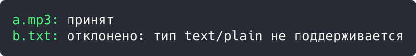

# Цель работы

Реализовать решение прикладной задачи из предметной области с использованием поведенческого паттерна «Цепочка обязанностей».

# Ход работы

## Задание 1. Цепочка валидации загрузки

Загрузка проверяется по шагам: лимит размера, тип файла, квота пользователя. Обработчики `SizeHandler`, `MimeHandler`, `QuotaHandler` связаны в цепочку и передают запрос дальше, либо отклоняют его.

```rust
struct Upload {
    name: String,
    size_bytes: usize,
    mime: String,
    user_uploads: usize,
}

trait Handler {
    fn next(self: Box<Self>, upload: &Upload) -> String;
}

struct SizeHandler {
    max_bytes: usize,
    next: Option<Box<dyn Handler>>,
}

impl Handler for SizeHandler {
    fn next(self: Box<Self>, upload: &Upload) -> String {
        if upload.size_bytes > self.max_bytes {
            return format!("отклонено: размер > {} МБ", self.max_bytes / 1_000_000);
        }
        match self.next {
            Some(n) => n.next(upload),
            None => "принят".into(),
        }
    }
}

struct MimeHandler {
    next: Option<Box<dyn Handler>>,
}
```

Демонстрация решения:

```rust
impl Handler for MimeHandler {
    fn next(self: Box<Self>, upload: &Upload) -> String {
        let allowed = ["audio/mpeg", "audio/wav"];
        if !allowed.contains(&upload.mime.as_str()) {
            return format!("отклонено: тип {} не поддерживается", upload.mime);
        }
        match self.next {
            Some(n) => n.next(upload),
            None => "принят".into(),
        }
    }
}

struct QuotaHandler {
    max_uploads: usize,
}
```

Продолжение решения:

```rust
impl Handler for QuotaHandler {
    fn next(self: Box<Self>, upload: &Upload) -> String {
        if upload.user_uploads >= self.max_uploads {
            return "отклонено: исчерпана квота".into();
        }
        "принят".into()
    }
}

fn make_chain() -> Box<dyn Handler> {
    Box::new(SizeHandler {
        max_bytes: 500_000_000,
        next: Some(Box::new(MimeHandler {
            next: Some(Box::new(QuotaHandler { max_uploads: 100 })),
        })),
    })
}

fn main() {
    let ok = Upload { name: "a.mp3".into(), size_bytes: 5_400_000, mime: "audio/mpeg".into(), user_uploads: 3 };
    let bad = Upload { name: "b.txt".into(), size_bytes: 900, mime: "text/plain".into(), user_uploads: 3 };
    println!("{}: {}", ok.name, make_chain().next(&ok));
    println!("{}: {}", bad.name, make_chain().next(&bad));
}
```



Рисунок 1 - Результат выполнения задания 1

Результат: `a.mp3` принят, `b.txt` отклонён: `text/plain не поддерживается`.

# Вывод

Прикладная задача решена цепочкой обязанностей: проверки размера, типа и квоты образуют расширяемый конвейер. Новый обработчик добавляется без изменения существующих, а запрос передается по цепочке до первого решения. Такой же приём уместен при валидации загрузки аудиофайлов в реальном приложении: лимит размера, поддержка формата и квота пользователя проверяются последовательными обработчиками. Отклонение и прием файла соответствуют настроенным проверкам, корректность подтверждена выводом программ.
