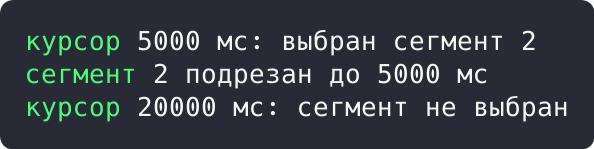
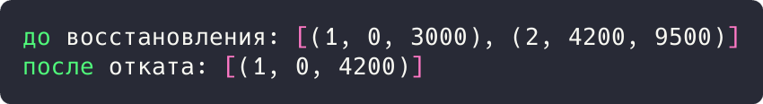

# Цель работы

Реализовать решение прикладной задачи из предметной области с использованием поведенческих паттернов «Посредник» и «Снимок».

# Ход работы

## Задание 1. Паттерн «Посредник»: координация аннотатора

Курсор и список сегментов не ссылаются друг на друга напрямую: посредник `Mediator` обрабатывает перемещение курсора, определяет выбранный сегмент и статус, а также выполняет подрезку.

```rust
struct Mediator {
    cursor_ms: u64,
    segments: Vec<(u32, u64, u64)>,
    selected: Option<u32>,
    status: String,
}

impl Mediator {
    fn new() -> Self {
        Mediator { cursor_ms: 0, segments: vec![(1, 0, 4_200), (2, 4_200, 9_500)], selected: None, status: String::new() }
    }

    fn move_cursor(&mut self, ms: u64) {
        self.cursor_ms = ms;
        self.selected = self
            .segments
            .iter()
            .find(|(_, s, e)| ms >= *s && ms <= *e)
            .map(|(id, _, _)| *id);
        self.status = match self.selected {
            Some(id) => format!("курсор {} мс: выбран сегмент {}", ms, id),
            None => format!("курсор {} мс: сегмент не выбран", ms),
        };
    }
```

Демонстрация решения:

```rust
    fn trim_selected(&mut self) {
        if let Some(id) = self.selected {
            if let Some(seg) = self.segments.iter_mut().find(|(sid, _, _)| *sid == id) {
                seg.1 = self.cursor_ms;
                self.status = format!("сегмент {} подрезан до {} мс", id, self.cursor_ms);
            }
        }
    }
}

fn main() {
    let mut m = Mediator::new();
    m.move_cursor(5_000);
    println!("{}", m.status);
    m.trim_selected();
    println!("{}", m.status);
    m.move_cursor(20_000);
    println!("{}", m.status);
}
```



Рисунок 1 - Результат выполнения задания 1

Результат: курсор 5000 мс выбрал сегмент 2, подрезка прошла, на позиции 20000 мс сегмент не выбран.

## Задание 2. Паттерн «Снимок»: откат аннотаций

Состояние списка сегментов сохраняется методом `snapshot()` без нарушения инкапсуляции и восстанавливается методом `restore()`.

```rust
struct AnnotationState {
    segments: Vec<(u32, u64, u64)>,
}

struct Snapshot {
    segments: Vec<(u32, u64, u64)>,
}

impl AnnotationState {
    fn snapshot(&self) -> Snapshot {
        Snapshot { segments: self.segments.clone() }
    }

    fn restore(&mut self, snap: Snapshot) {
        self.segments = snap.segments;
    }
}

fn main() {
    let mut state = AnnotationState { segments: vec![(1, 0, 4_200)] };
    let snap = state.snapshot();

    state.segments.push((2, 4_200, 9_500));
    state.segments[0].2 = 3_000;
    println!("до восстановления: {:?}", state.segments);

    state.restore(snap);
    println!("после отката: {:?}", state.segments);
}
```



Рисунок 2 - Результат выполнения задания 2

Результат: после правок состояние `[(1, 0, 3000), (2, 4200, 9500)]`; откат вернул `[(1, 0, 4200)]`.

# Вывод

Прикладная задача решена с использованием перечисленных паттернов; корректность подтверждена выводом программ.
